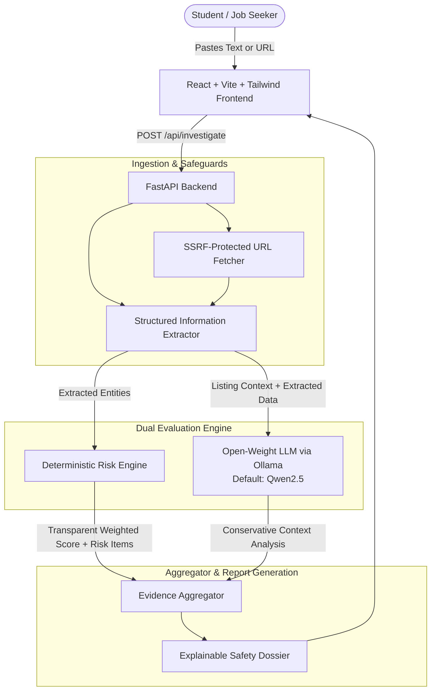

# InternShield 🛡️
> **"Think before you apply."**  
> An open-source AI-powered internship investigation assistant for students who encounter suspicious job opportunities, recruiters, and training offers online.

[](https://hacktoberfest.com/)
[](https://opensource.org/licenses/MIT)
[](https://fastapi.tiangolo.com)
[](https://react.dev/)
[](https://ollama.com/)

---

## 📌 Problem

College students searching for internships online frequently encounter questionable job listings, unsolicited WhatsApp offers, suspicious recruiter emails, and third-party application forms. 

Students commonly face:
- **Upfront registration or training fees** masked as "refundable security deposits"
- **Free public email accounts** (e.g. `@gmail.com`) claiming to represent major corporations
- **Direct selection guarantees** with "NO INTERVIEW REQUIRED"
- **Urgency tactics** ("today only", "only 10 seats remaining") intended to force hasty payments
- **Requests for sensitive personal or financial credentials** (OTPs, bank account logins, UPI PINs)
- **Unrealistic compensation promises** for trivial daily hours

Students often lack an accessible, objective tool to evaluate whether an opportunity deserves their trust before they share personal information or hand over money.

---

## 🤝 Built-For-A-Friend Story

InternShield was created for a college student and close friend navigating technical internship applications. While searching on LinkedIn and job forums, they repeatedly encountered listings that looked superficially authentic but ended with a recruiter asking for an upfront ₹1,499 "seat confirmation fee." 

Recognizing that many students either get deceived or become paralyzed with anxiety about whether an offer is legitimate, InternShield was engineered to act as a **supportive, objective second pair of eyes**.

---

## 🎯 What It Does

InternShield analyzes raw internship descriptions or public job posting URLs and produces an **evidence-backed, explainable safety report**.

### ⚠️ Critical Guiding Principle
**InternShield NEVER declares: "THIS INTERNSHIP IS FAKE."**  
Instead, the system classifies findings into calibrated risk tiers:
- 🟢 **Low Risk Indicators (0 - 24)**: Verified company domains, multi-round technical assessment, transparent compensation, no fees.
- 🟡 **Needs Verification (25 - 49)**: Unaffiliated recruiter domains or early-stage startups warranting independent cross-checking.
- 🔴 **High Risk Indicators (50+)**: Mandatory applicant fees, sensitive credential requests, extreme urgency, or guaranteed placement claims.

The system clearly differentiates:
1. **Verified Evidence**: Extracted quotes from the posting.
2. **Warning Signs**: Explainable risk indicators with points breakdown.
3. **What Looks Normal**: Legitimate hiring signals identified in the post.
4. **Could Not Verify**: Specific details that cannot be proven from text alone.
5. **AI Analysis**: Conservative context evaluation by an open-weight model.
6. **Recommended Next Steps**: Concrete due-diligence checklist for the applicant.

---

## 🏗️ Architecture



---

## 🧠 Open-Source / Open-Weight AI Core

In strict accordance with the **Hacktoberfest 2026** challenge requirements:
- **No Proprietary AI APIs**: InternShield does **NOT** rely on OpenAI, Anthropic, or Google Gemini APIs for inference.
- **Local Open-Weight Model**: Powered by open-weight models executed locally through **[Ollama](https://ollama.com/)**.
- **Configurable Model Family**: Default configured model is `qwen2.5:0.5b` (or `qwen2.5:3b`, `qwen3:4b`), configurable via the `OLLAMA_MODEL` environment variable.
- **Model License**: Qwen models are released under the permissive **Apache 2.0 License**, ensuring full open innovation and commercial/academic freedom.
- **Conservative Guardrails**: The LLM prompt strictly instructs the model to analyze evidence conservatively, distinguish facts from inference, and never declare guilt or legal fraud.
- **Graceful Deterministic Fallback**: If Ollama is offline or loading, InternShield’s rule engine continues executing 100% of risk checks without failing.

---

## 💡 Why Open Innovation Matters

1. **Student Privacy**: Resumes, sensitive job offers, and private recruiter messages never leave the user's machine.
2. **Zero Recurring Cost**: Free of per-token API charges or subscription paywalls.
3. **Model Sovereignty & Portability**: Anyone can run, fork, audit, or swap the underlying model (Qwen, Gemma, Llama, Mistral).
4. **Auditability & Explainability**: Every flagged score impact (`+30`, `+15`, `+10`) is backed by deterministic rules and explicit evidence quotes.

---

## ⚙️ Installation & Running Locally

### Prerequisites
- **Python 3.10+** (Tested on Python 3.13)
- **Node.js 18+** (Tested on Node.js v24)
- **Ollama** installed and running on `http://localhost:11434`

### 1. Set Up Ollama & Open-Weight Model
```bash
# Verify Ollama is installed
ollama --version

# Pull the lightweight Qwen model (or any preferred open-weight model)
ollama pull qwen2.5:0.5b

# Start Ollama service (if not already running as a background service)
ollama serve
```

### 2. Set Up Backend (FastAPI)
```bash
# Navigate to backend directory
cd backend

# Install dependencies
python -m pip install -r requirements.txt

# Run backend automated test suite
python test_engine.py

# Start FastAPI development server on port 8000
python -m uvicorn app.main:app --host 127.0.0.1 --port 8000 --reload
```

### 3. Set Up Frontend (React + Vite + Tailwind)
```bash
# Navigate to frontend directory in another terminal
cd frontend

# Install dependencies
npm install

# Start Vite frontend server on port 5173
npm run dev
```

Open **http://localhost:5173** in your browser.

---

## 🧪 Required Test Case Verification

Test the application immediately using the built-in demo buttons or paste the following text:

```text
Data Science Internship at NexaByte Technologies
We are selecting students for our remote Data Science Internship Program. Earn ₹35,000 per month while working 2 hours per day. NO INTERVIEW REQUIRED. You have been shortlisted directly. Only 10 seats remaining. To confirm your internship seat, submit a refundable registration fee of ₹1,499. Payment must be completed today. Contact: nexabyte.recruitment@gmail.com
```

### Detections Produced:
- 🔴 **Applicant Payment Requested (+30)**: Detected `₹1,499` registration fee.
- 🟠 **Generic Recruiter Email (+10)**: Free `gmail.com` address instead of company domain.
- 🟠 **Domain Mismatch (+15)**: Recruiter contact does not match `NexaByte Technologies`.
- 🟠 **No Interview / Direct Selection (+10)**: "NO INTERVIEW REQUIRED" claim.
- 🟠 **Urgency Tactics (+10)**: "Payment must be completed today", "Only 10 seats remaining".
- 🟠 **Disproportionate Earnings (+10)**: "Earn ₹35,000 per month while working 2 hours per day".

**Result**: **85 / 100 — HIGH RISK INDICATORS (🔴)**  
*(NexaByte Technologies is synthetic demo data used for test verification).*

---

## ⚠️ Limitations & Safety Disclaimer

- **Informational Purpose Only**: InternShield summarizes detected warning indicators and structural anomalies. It is **not** legal advice, background verification, or definitive proof of criminal fraud.
- **Legitimate Edge Cases**: Some early-stage open-source projects or pre-incorporation startups legitimately use generic emails (e.g. Gmail); these are flagged as *Needs Verification*, not fraud.
- **Applicant Due Diligence**: Students must always independently verify organizations through corporate registries, official company domains, and established career portals before transferring funds or sharing credentials.

---

## 📄 License

InternShield is released under the **MIT License**.
Developed with pride for the **Hacktoberfest 2026 Weekend Challenge** ("Build for a Friend").
